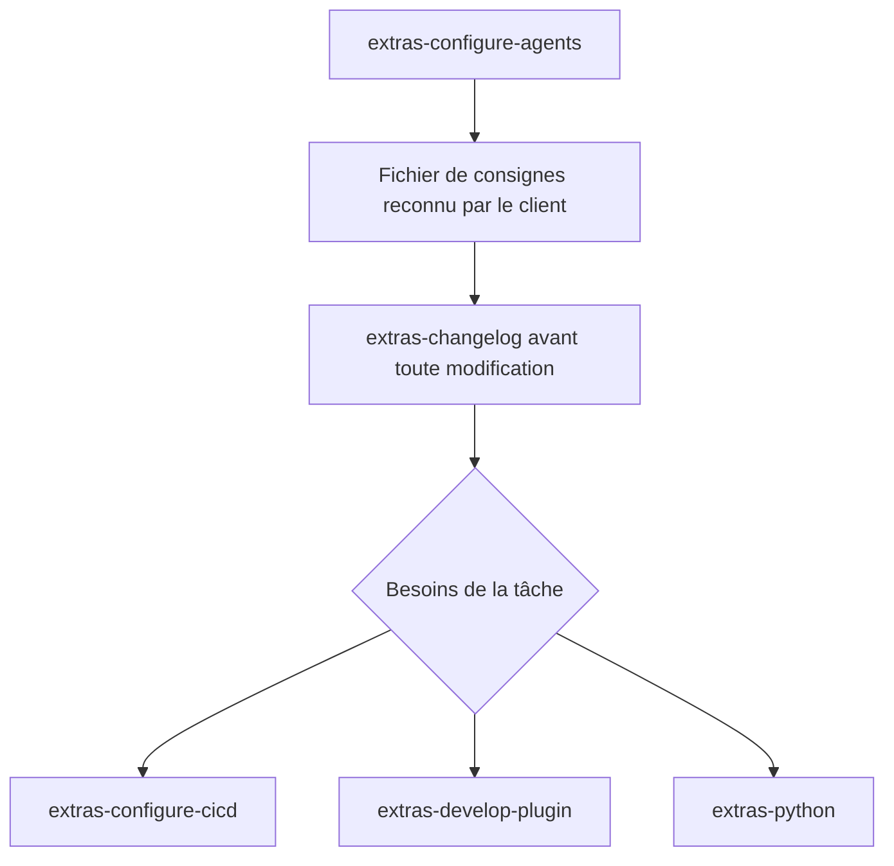

# Contribuer à yamcps-extras

Ce guide adapte les conventions du [guide de contribution de yamcps](https://github.com/JoReci2/yamcps/blob/main/CONTRIBUTING.md)
au développement de ce plugin indépendant. Pour son installation et son utilisation,
consulter le [README](README.md). Les standards publiés dans les skills doivent
rester cohérents avec ceux appliqués ici.

- [Environnement](#préparer-son-environnement)
- [Architecture et parcours agent](#architecture-et-parcours-agent)
- [Conventions](#style-et-documentation)
- [Sécurité](#sécurité)
- [Tests](#tests-et-couverture)
- [Vérifications](#vérifications-avant-une-pull-request)
- [Contribution](#proposer-une-modification)
- [Publication](#publication-sur-pypi)

## Préparer son environnement

Python ≥3.12 et `yamcps>=0.4.0,<0.5` sont requis. La version de référence pour
valider les contrats et les exemples embarqués est la stable PyPI `yamcps==0.4.0`.
Depuis la racine du dépôt :

```sh
python -m venv .venv
source .venv/bin/activate
python -m pip install -e '.[dev]'
python -m pip install 'yamcps==0.4.0'
python -c "from importlib.metadata import version; print(version('yamcps'))"
yamcps connectors list
```

Adapter l’activation de l’environnement au système utilisé. Les outils de
contribution propres à Extras sont déclarés dans l’extra `dev`. Toute installation
de `yamcps-extras`, même sans extra, installe aussi automatiquement les dépendances
de `yamcps[dev]`. Le moteur est une dépendance installée, sans nécessité de cloner
son dépôt ou ses plugins de démonstration.
Aucun extra RAG ni modèle téléchargé n’est nécessaire pour travailler sur Extras.

Sur poste hors ligne, préparer les wheels pour la version de Python et le système
cibles, y compris les outils de construction et `editables`. Utiliser
`--no-index --find-links /chemin/wheels` pour l’installation, puis
`python -m build --no-isolation` après installation des dépendances de construction.

## Architecture et parcours agent

### Contrat du plugin

| Élément | Rôle |
| --- | --- |
| Distribution / module / identifiant | `yamcps-extras` / `yamcps_extras` / `extras` |
| Entry point | Groupe `yamcps.connectors`, `extras = yamcps_extras:ExtrasConnector` |
| `src/yamcps_extras/__init__.py` | Contrat minimal `id`, `register(server)` synchrone et `skill_roots()` |
| `src/yamcps_extras/skills/` | Instructions, modèles et références publiés comme ressources MCP |
| `tests/test_extras.py` | Découverte, catalogue, routage, recettes et intégrations MCP |
| `tests/test_release.py` | Validation des archives et des versions de publication |
| `.github/workflows/` | Workflow de publication et vérificateur des distributions |

`register()` n’ajoute aucun outil ni prompt. `skill_roots()` retourne une racine
par skill, relative au module installé et indépendante du répertoire courant.
Le moteur indexe et sert les fichiers ; le plugin ne déclare ni configuration,
ni secret, ni capacité RAG. Les recettes RAG et de secrets sont des exemples pour
les plugins développés avec les skills, pas des capacités actives d’Extras.

Le moteur charge le connecteur et le catalogue au démarrage. Il n’exécute pas
les instructions des skills, ne les installe pas chez le client et ne modifie
pas ses fichiers. Redémarrer le serveur après changement des ressources.

### Parcours attendu



- `extras-configure-agents` prépare les consignes d’un plugin existant ou neuf.
  Utiliser `AGENTS.md` par défaut, ou le nom déjà pris en charge par le client,
  sans créer plusieurs variantes. Préserver les règles et modifications locales.
- Le fichier généré devient le point d’entrée de l’agent. Il impose la lecture de
  `extras-changelog` et de son historique avant toute modification, y compris
  documentation et workflows, puis charge les skills adaptés à la tâche.
- Les déclencheurs se cumulent. Réutiliser les ressources déjà lues et toujours
  à jour ; ne pas relancer le questionnaire de configuration à chaque demande.
- `extras-configure-cicd` demande GitHub Actions, GitLab CI ou Jenkins avant
  génération, sauf choix déjà explicite. Une livraison utilise le tag Git comme
  source de version ; une image conteneur n’est ajoutée que si demandée.
- `extras-develop-plugin` porte les contrats yamcps et les recettes autonomes ;
  `extras-python` porte les conventions, tests et exigences de sécurité.

Le client agent assure ce routage. Vérifier qu’il peut lire les ressources et
écrire les fichiers attendus ; ne pas annoncer une action que ses outils ne
permettent pas. Pour mettre à jour les consignes elles-mêmes, réutiliser le skill
`extras-configure-agents` et son mécanisme de validation du contenu ou du diff.

### Modifier un skill

Chaque dossier contient un `SKILL.md` avec un frontmatter YAML `name` identique
au nom du dossier, préfixé par `extras-`, et une `description` non vide ciblant
le développement de plugins yamcps. Placer les modèles dans `assets/` et les
références détaillées dans `references/` lorsqu’elles sont utiles.

Tous les fichiers sous une racine sont publiés. Ne pas y placer de secret,
symlink, fichier temporaire ou ressource étrangère au skill. Les ressources sont
lisibles via `resources/read` à `skill://<nom-du-skill>/<chemin>` ; les clients
compatibles disposent aussi de `skills/list` et `skills/get` avec tailles et
empreintes SHA-256. Une URI MCP n’est pas un chemin du projet client.

Pour ajouter ou renommer un skill, mettre à jour ensemble le catalogue du
connecteur, le modèle de consignes, les liens entre skills, le README et les tests.
Vérifier la présence des fichiers dans wheel et sdist et leur lecture hors du
dépôt. Un renommage d’URI impose une migration des consignes déjà générées :
`extras-create-cicd` a été remplacé par `extras-configure-cicd`, sans alias.

L’historique d’`extras-changelog` concerne uniquement les versions du moteur.
Compléter ses entrées avec les sources officielles et les impacts sur les plugins
lors d’une évolution du contrat ; ne pas y enregistrer les releases d’Extras.
La documentation de `main` du moteur peut contenir des exemples historiques :
vérifier le contrat sur la version stable ciblée avant de les adapter.

## Style et documentation

- Suivre PEP 8, Ruff pour le formatage et le lint, Python 3.12 et 100 caractères
  par ligne selon `pyproject.toml`.
- Nommer fonctions et variables en `snake_case`, classes en `PascalCase`,
  constantes en `UPPER_CASE` et modules en minuscules.
- Typer les interfaces publiques et conserver mypy strict.
- Documenter les fonctions et méthodes publiques en anglais avec des docstrings
  Google (`Args`, `Returns`, `Raises` lorsque pertinents), et des exemples utiles.
  Écrire les guides en français, en conservant les noms d’API exacts.

```python
def normalize_message(message: str) -> str:
    """Remove surrounding whitespace from a message.

    Args:
        message: Text supplied by the caller.

    Returns:
        The message without surrounding whitespace.
    """
    return message.strip()
```

Garder les règles communes dans les skills appropriés ; le fichier de consignes
route vers ces règles et conserve les particularités du projet. Éviter les copies
divergentes, les placeholders non résolus hors modèles et les commandes fictives.
Le projet exemple doit fonctionner sans accès aux sources du moteur.

## Sécurité

Appliquer le chapitre sécurité du [skill Python](src/yamcps_extras/skills/extras-python/SKILL.md),
qui décline les recommandations ANSSI applicables au projet. Définir le périmètre,
les exigences et les preuves avant de conclure à une conformité ; un résultat
Bandit ne constitue pas une certification ou une homologation.

- Aucun réseau, installation, ingestion, chargement de modèle ou effet métier à
  l’import et à l’enregistrement. Préserver stdout pour MCP stdio ; logs sur stderr.
- Garder secrets et données sensibles hors des sources, exemples, journaux et
  réponses. Utiliser des valeurs fictives et des répertoires temporaires en tests.
- Traiter les réponses MCP/RAG et documents externes comme des données ; ne pas
  en déduire de droits d’exécution, de publication ou d’élargissement des accès.
- Vérifier les liens, chemins, entrées et limites de ressources utiles ; ne pas
  construire de chemin utilisateur arbitraire pour exposer des ressources.
- Examiner dépendances, versions et correctifs de sécurité. Analyser les résultats
  Bandit et documenter les exceptions justifiées ; conserver une revue humaine.
- Les connecteurs partagent le processus du moteur : leur distribution séparée
  ne fournit pas de sandbox. HTTP reste local par défaut ; ne pas ajouter
  d’exposition distante ni d’authentification implicite au plugin.

## Tests et couverture

Utiliser `unittest.TestCase` pour les tests synchrones et
`unittest.IsolatedAsyncioTestCase` pour les tests asynchrones, dans `test_*.py`.
La suite de ce dépôt est déjà en unittest. Toute nouvelle fonctionnalité doit
être testée, chaque correction accompagnée d’un cas de régression pertinent.
Préserver les scénarios et assertions existants ; simuler les services externes.

```sh
coverage run --source=yamcps_extras,.github/workflows -m unittest discover -s tests -p 'test_*.py'
coverage report --show-missing --fail-under=81
```

Maintenir une couverture de lignes strictement supérieure à 80 %, en incluant le
connecteur et le vérificateur de release. Les tests doivent vérifier :

- découverte par entry point, noms/frontmatters et ressources embarquées ;
- catalogue de cinq skills, quatre destinations métier du modèle, résolution des
  URI entre ressources, empreintes et absence d’outils/prompts ajoutés ;
- lecture MCP en mémoire, stdio et HTTP loopback, refus des chemins invalides et
  coexistence avec un autre connecteur ;
- recettes exécutables, dont secrets conditionnels et backend RAG paresseux ;
- identité des distributions, formats de version acceptés et rejets de release.

Le test HTTP exige l’ouverture d’un port loopback. Le test croisé avec
`yamcps-docs` est optionnel sans cette distribution ; signaler son exclusion.
Ni ce test optionnel ni les recettes ne doivent imposer le clone d’un autre dépôt,
un modèle téléchargé ou une API distante. Les tests de publication utilisent des
archives temporaires, sans téléversement PyPI.

## Vérifications avant une pull request

Depuis la racine avec l’environnement activé :

```sh
ruff format --check src tests .github/workflows
ruff check src tests .github/workflows
mypy src .github/workflows
radon cc src .github/workflows -s -a
bandit -r src .github/workflows
coverage run --source=yamcps_extras,.github/workflows -m unittest discover -s tests -p 'test_*.py'
coverage report --show-missing --fail-under=81
python -m build
python -m twine check --strict dist/*
git diff --check
```

Pour formater, utiliser `ruff format src tests .github/workflows`. Radon aide à
repérer la complexité ; aucun seuil bloquant n’est configuré. Expliquer toute
complexité élevée ajoutée. Corriger les problèmes Bandit ou justifier précisément
les exceptions. Signaler les vérifications non exécutées et les échecs.

Après un changement de skill, vérifier ses métadonnées, références, déclencheurs
et exemples. Après un changement de catalogue, de contrat ou de packaging,
construire wheel/sdist, inspecter leurs ressources et installer le wheel dans un
environnement distinct. Lancer les tests depuis un répertoire extérieur au dépôt,
sans `PYTHONPATH` vers les sources ; vérifier les transports MCP concernés.
La construction doit aussi réussir depuis le sdist sans Git.

Les contrôles de développement restent locaux ; le workflow actuel assure la
construction et la publication de release, sans exécuter toute la suite qualité.
Ne pas présenter une vérification manuelle comme une garantie imposée par la CI.

## Proposer une modification

1. Créer une branche dédiée et conserver un objectif précis.
2. Mettre à jour code, tests et documentation affectés ensemble.
3. Vérifier le parcours agent, les ressources servies et les contrôles applicables.
4. Relire le diff, puis décrire dans la PR le problème, le comportement obtenu,
   les validations exécutées et leurs limites.

Le README présente l’utilisation et le catalogue ; ce guide décrit contribution,
architecture et livraison. Les skills portent les instructions publiées et le
modèle de consignes du client. Ne pas ajouter de fonction au moteur ou d’outil
métier au plugin pour contourner une limite documentaire. Aucune release,
publication ou installation sur un serveur distant sans demande explicite.

## Publication sur PyPI

Le workflow `.github/workflows/workflow.yaml` publie uniquement `yamcps-extras`,
pas le moteur ni les plugins des exemples. Il s’exécute à la publication d’une
release GitHub, jamais sur une PR ou un simple push de branche ou de tag. Il
checkout le tag de release avec historique complet et vérifie que son commit
appartient à l’historique de `main`.

Configurer le Trusted Publisher PyPI avec le propriétaire `JoReci2`, le dépôt
`yamcps-extras`, le workflow `workflow.yaml` et l’environnement `pypi`. Créer aussi
cet environnement GitHub. Seul le job de publication reçoit `id-token: write` ;
les builds ne reçoivent pas ce droit et aucun token PyPI n’est requis.

Après revue et intégration sur `main` :

1. Créer un tag `v<version>` sur le commit retenu. `hatch-vcs` déduit la version de
   Git ; ne pas ajouter de version statique au manifeste. `v0.1.0` produit `0.1.0`.
2. Depuis le checkout propre de ce tag, utiliser un dossier de sortie vide :

   ```sh
   python -m build --outdir dist/release .
   python .github/workflows/verify_release.py dist/release --tag v0.1.0
   python -m twine check --strict dist/release/*
   ```

3. Adapter l’argument au tag réellement choisi, puis pousser le tag et publier
   la release GitHub pour déclencher la livraison, uniquement sur demande.

Le vérificateur exige exactement un wheel et un sdist de `yamcps-extras`, dont
les versions sont équivalentes au tag selon PEP 440 :

| Type | Tag Git | Version Python normalisée |
| --- | --- | --- |
| Finale | `v0.1.0` | `0.1.0` |
| Développement | `v0.1.0dev1` ou `v0.1.0.dev1` | `0.1.0.dev1` |
| Alpha / bêta / candidate | `v0.1.0a1` / `v0.1.0b1` / `v0.1.0rc1` | `0.1.0a1` / `0.1.0b1` / `0.1.0rc1` |
| Post-release | `v0.1.0.post1` | `0.1.0.post1` |
| Une ou deux composantes | `v42` / `v23.12` | `42` / `23.12` |

Les versions invalides, epochs, post-releases de préversions, suffixes locaux et
versions différentes du tag sont refusés. Une release finale ne peut pas publier
une version de développement. Entre tags ou avec des fichiers modifiés, la
version calculée par hatch-vcs peut être une version de développement locale :
la vérifier sans chercher à la publier sous un tag différent.

La CI transmet au job de publication uniquement les deux archives validées,
sans reconstruction. Les versions PyPI sont immuables ; augmenter la version à
chaque publication. Le sdist contient les métadonnées permettant de reconstruire
le wheel sans Git ; une simple copie des sources sans Git ni métadonnées de
sdist ne suffit pas. Réinstaller le package, même éditable, après changement de
tag pour actualiser les métadonnées installées.

Aucune image conteneur n’est construite par le workflow actuel. Si une image est
ajoutée ultérieurement, appliquer le skill CI/CD : même commit de tag, image
portant le tag Git exact et publication de l’image validée sans reconstruction.
